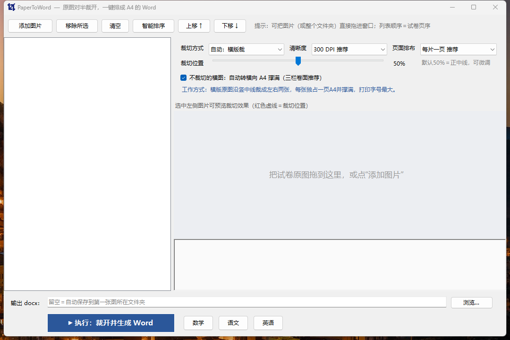
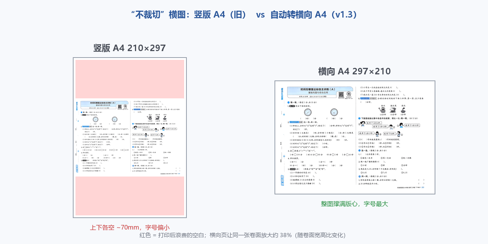

# PaperToWord

> 试卷原图对半裁开，一键排成 A4 的 Word —— 打印字号最大化的桌面小工具

[](#构建)
[](#系统要求)
[](https://github.com/ekoz/PaperToWord/releases/latest)
[](https://github.com/ekoz/PaperToWord/actions/workflows/build.yml)
[](#构建)
[](#快速开始)

手机横拍的试卷（一张照片 = 试卷两页），直接打印会整体缩小、字很小。
PaperToWord 沿中线把照片裁成左右两片，**每片独占一页 A4 并撑满版心**，重新打印出来的字号约是整图直印的 **2 倍**。

生成的 `.docx` 不依赖本机安装任何 Office——文档由程序按 OOXML 标准手工组装，WPS / Word 2007+ 直接打开。

**双击即用 · 单文件 104KB · 无需安装 · 无需联网 · 无需 Python/Node/Office**

👉 **[下载 PaperToWord.exe](https://github.com/ekoz/PaperToWord/releases/latest)**（Releases 页，Windows 10/11 直接双击运行）



---

## 为什么需要它

| 场景 | 痛点 | PaperToWord 的做法 |
|------|------|--------------------|
| 横版试卷照片（一张 = 两页） | 整图打印时缩到一半大小，字太小 | 沿竖中线裁成左右两片，每片独占一页撑满 |
| 三栏连排的大卷面（裁开会切断中栏） | 裁不得、整图打印又上下留白 | 选"不裁切"，该页自动转**横向 A4** 撑满 |
| 中间有装订孔 / 订书钉印 | 正中线裁切会切到题目 | 裁切位置滑杆 30%–70% 微调 |
| 想省纸 | 一页放不下一页 | "两片同页上下排"模式 |

## 核心特性

- **对半裁切，逐片撑满**：横图自动沿竖中线裁左右两片；每片独占一页 A4（200×287mm 版心），打印字号最大化
- **三栏卷自适应**：不裁切的横图自动改用横向 A4（297×210mm）整页撑满——转的是页面方向，不是图片内容，打印不用歪头看
- **EXIF 方向纠正**：手机竖拍/倒拍的照片自动转正后再裁
- **清晰度四档**：150 / 200 / 300 DPI（默认，打印推荐）/ 原图；长边默认限 4600px 防文档爆大
- **输出安全**：同目录临时文件原子落盘；目标重名或被 Word 占用时自动改名 `_2`…`_199`，**绝不覆盖**；源图片只读
- **智能命名**：默认输出 `当日日期-.docx`；数学 / 语文 / 英语 一键填充 `20261119-shuxue.docx` 式文件名（拼音，避免中文文件名兼容问题）
- **自然排序**：`第2页` 排在 `第10页` 前；上移/下移（支持多选）调序，列表顺序即页序
- **GUI + CLI 双入口**：同一 exe，命令行可批量静默转换
- **零依赖单 exe**：仅用 .NET Framework BCL，docx 的 OOXML 与 ZIP 均为自研实现

## 三栏卷的自适应（v1.3）



对宽>高的横图（典型如三栏连排卷面），把"裁切方式"选为**不裁切**即可：程序不会旋转图片内容，而是把该页的纸张方向自动切换为横向 A4，整图撑满 287×200mm 版心。同一份文档里可以逐页混合竖版/横版（每页独立分节），互不影响。

## 快速开始

1. 下载 `dist/PaperToWord.exe`（拷到任何 Win10/11 机器都能跑，无需安装）
2. 把试卷照片（或整个文件夹）拖进窗口
3. 点 **▶ 执行：裁开并生成 Word**，自动弹出结果

```
输入：横版试卷照片 ×N          输出：1 份 .docx（每张图 1–2 页 A4）
```

## 命令行

```powershell
# 批量转换（无窗口，完成后打印结果路径与页数）
PaperToWord.exe "D:\试卷\01.png" "D:\试卷\02.png" --out="D:\试卷\20261119-数学.docx"

# 只给文件名：自动落到第一张图所在目录（PowerShell 通配符需先展开）
PaperToWord.exe (Get-ChildItem "D:\试卷\*.jpg").FullName --out=20261119.docx

# 不给 --out：默认输出到图片目录，文件名 = 当日日期-.docx
PaperToWord.exe "D:\试卷\01.png"
```

`--out` 支持 `--out=路径` 与 `--out 路径` 两种写法。退出码：`0` 成功；`1` 无有效图片或写入失败（原因打印到 stdout）。

## 工作原理

```
手机横拍照片 (4896×3497)
   │  EXIF 转正 → 长边限 4600px
   ▼
裁切方案（自动/左右/上下/不裁切，位置 20%–80% 钳制）
   │  HighQualityBicubic 按 DPI 预算重采样 → JPEG（300DPI 档 q88，其余 85/92）
   ▼
页面装配：每片 → 独占一页 A4，按版心 EMU 等比撑满
   │  每页独立 sectPr（可混合竖版/横向）
   ▼
OOXML 手工组装 → ZIP(store) → 原子落盘 .docx
```

关键换算：1mm = 36000 EMU；A4 = 11906×16838 twip；页边距 5mm；竖版版心 200×287mm，横向版心 287×200mm。

## 构建

无需安装任何 IDE——用 Windows 自带的 .NET Framework 编译器：

```powershell
powershell -ExecutionPolicy Bypass -File build.ps1
# → dist\PaperToWord.exe
```

约束（详见 [`docs/harness/index.md`](docs/harness/index.md)）：

- 源码为 **C# 5** 语法上限（系统 csc 只支持到 C#5）
- **零第三方依赖**：只引用 System / System.Core / System.Drawing / System.Windows.Forms
- 图标双参数缺一不可：`/win32icon`（资源管理器图标）+ `/resource:app.ico,AppIcon`（窗口图标）

### CI 自动构建与发布

推送到 `main`/`master` 会触发 [`.github/workflows/build.yml`](.github/workflows/build.yml)：
在 `windows-latest` 上用系统自带 csc 跑同一个 `build.ps1`，再做架构不变量检查与冒烟测试（合成一张试卷图 → 生成 docx → 校验 ZIP 与 OOXML）。

打 tag 即发版，无需手动编译或上传：

```powershell
git tag v1.3.1
git push origin v1.3.1     # 触发 release：产物挂到 GitHub Releases
```

exe 不入库（`.gitignore` 已排除 `dist/PaperToWord.exe`），只作为 Release 附件分发；完整使用说明同时渲染在 Release 页面正文里。

## 项目结构

```
PaperToWord/
├── AGENTS.md              # AI 编码工具的项目入口（约束速览 + 文档导航）
├── CLAUDE.md              # 一行指针，转介到 AGENTS.md（兼容旧宿主）
├── build.ps1              # 可复现构建脚本（含占用预检）
├── Source/
│   ├── Program.cs         # 入口：GUI/CLI 分流
│   ├── Core.cs            # 裁切/缩放/排版核心（Config·Cutter·Sizer·DocxBuilder）
│   ├── Ooxml.cs           # OOXML 手工组装（每页独立分节）
│   ├── Zip.cs             # 自研 ZIP 写入器（store + CRC32）
│   ├── MainForm.cs        # WinForms 界面（TableLayoutPanel 布局）
│   └── NatSort.cs         # 自然排序（第2页 < 第10页）
├── dist/
│   ├── PaperToWord.exe    # 产物（104KB，由 CI 生成，不入库）
│   └── 使用说明.txt        # 给终端用户的说明（同时渲染进 Release 正文）
└── docs/                  # HelixHarness 工程体系
    ├── harness/           #   架构约束 + lint 脚本
    ├── knowledge/         #   能力地图 / BR-01~16 / 踩坑经验库
    └── assets/            #   本文配图
```

## 系统要求

| 项目 | 要求 |
|------|------|
| 操作系统 | Windows 10 / 11（自带 .NET Framework 4.8；Win7 需已装 4.x） |
| 运行时依赖 | 无（不装 Python / Node / VC++ 运行库） |
| 网络 | 不需要，全程离线 |
| 打开结果 | 需 WPS 或 Word 2007+（仅打开用，生成不需要） |

## FAQ

**Q：生成的文档字还是小？**
A：确认"页面排布"= 每片一页（默认）；一张照片对应两页试卷时，"裁切方式"保持自动即可裁成两片。

**Q：三栏卷被切成两半、中间栏断了？**
A：把"裁切方式"改为**不裁切**，勾选"自动转横向 A4 撑满"（默认已勾），打印时选横向纸。

**Q：裁切线正好压在装订孔上？**
A：拖动"裁切位置"滑杆微调（30%–70%），右侧预览红虚线实时显示切在哪。

**Q：目标文件被 Word 打开着会覆盖吗？**
A：不会。自动改名 `_2`…`_199`，仍冲突则追加时分秒；写入失败会清理临时文件，已有文件不受影响。

---

*本项目按 HelixHarness 规范管理：约束见 `docs/harness/`，业务规则与踩坑经验见 `docs/knowledge/`。*
