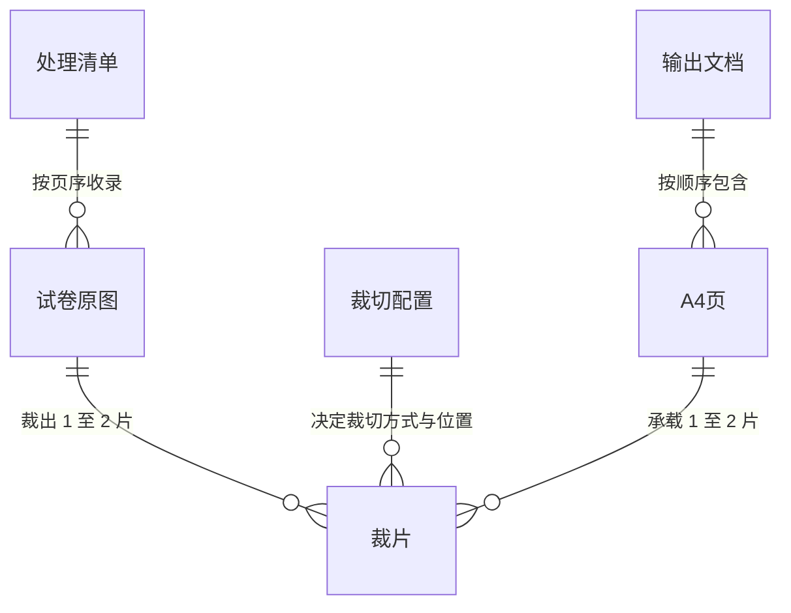

# PaperToWord 能力地图

> 生成时间：2026-11-19
> 服务版本：PaperToWord v1.3
> 文档性质：业务能力视角（面向产品与业务开发），不描述技术实现细节

---

## 1. 服务定位

| 项目 | 内容 |
| :--- | :--- |
| 服务职责 | 把手机横版拍摄的试卷图片沿中线裁成左右（或上下）两片，每片按打印最优方式排成 A4 页面并打包成一份标准 Word（.docx）文档，让重新打印出来的字号足够大、版面不浪费。 |
| 系统角色 | 通用域（独立运行的 Windows 桌面效率工具，不被任何其他系统或服务调用，也不对外提供能力）。 |
| 上游调用方 | 本机终端使用者：图形界面操作，或命令行批量调用。无其他业务方依赖本工具。 |
| 下游业务依赖 | 无外部业务服务。仅依赖操作系统文件系统（读图片、写 docx）与 .NET Framework 运行时；用户确认"打开结果"时调用系统默认程序或资源管理器，不属于业务依赖。 |

---

## 2. 核心业务场景

> 本工具承载的最重要的 5 个业务场景。图例：`[R]` 只读数据、`[W]` 本工具写出的数据、`[M]` 仅存在于本次运行内存。

| 场景 | 触发条件 | 业务目标 | 涉及数据 | 外部业务依赖 |
| :--- | :--- | :--- | :--- | :--- |
| **试卷图片导入与页序整理** | 用户拖入图片/文件夹、点"添加图片"，或命令行传入图片路径 | 汇总本次要处理的试卷图片，按正确的试卷页序排列，避免漏页和错序 | `[R] 试卷图片文件` `[M] 处理清单` | - |
| **横版试卷对半裁切并逐片排 A4** | 用户点击"执行：裁开并生成 Word"（列表非空） | 把一张横版卷面切成左右两片，每片独占一页 A4 并撑满，打印字号最大化 | `[R] 试卷图片文件` `[M] 裁片`、`A4 页` `[W] 输出 docx` | - |
| **不便裁切的大卷面整页横向输出** | 选择"不裁切"（典型为三栏连排卷面，裁开会把中间一栏切断） | 整图放入一页，并自动改用横向 A4（297×210mm）撑满，避免上下大片留白 | `[R] 试卷图片文件` `[W] 输出 docx` | - |
| **两片同页省纸输出** | 在"页面排布"中选择"两片同页" | 把同一张卷面裁出的两片上下排在同一页 A4 上，节省打印用纸 | `[R] 试卷图片文件` `[M] 裁片` `[W] 输出 docx` | - |
| **命令行批量转换** | 进程以图片路径或 `--out` 参数启动 | 不打开界面，一次把多张图片直接转换成 docx，便于脚本化或固定流程使用 | `[R] 试卷图片文件` `[W] 输出 docx` | - |

---

## 3. 业务模块

### 3.1 图片收集与页序管理

解决"一批试卷照片如何变成有序、不重复、可人工纠偏的处理清单"的问题。本模块只处理路径与顺序，不修改源图片；列表顺序即最终输出页序，是后续裁切与排版的上游输入。

| 能力名称 | 业务说明 | 涉及数据表 (R/W) | 外部业务依赖 |
| :--- | :--- | :--- | :--- |
| 图片导入 | 支持拖入文件/文件夹或通过文件选择框添加，只收录受支持的图片格式；拖入文件夹时只展开顶层文件，不递归子目录 | `[R] 试卷图片文件` `[M] 处理清单` | 操作系统·文件系统 |
| 重复项过滤 | 同一图片（按完整路径、不区分大小写）不会重复进入列表 | `[M] 处理清单` | - |
| 自然排序 | 按文件名排序，文件名中的连续数字按数值大小比较（"第2页"排在"第10页"前），非数字部分忽略大小写 | `[M] 处理清单` | - |
| 人工调整页序 | 提供上移/下移（支持多选整体移动）、移除所选、清空，修正自动排序与实际试卷页序的偏差 | `[M] 处理清单` | - |

### 3.2 裁切与版面适配

解决"一张横版卷面如何切成两页、切在哪里、每片放到什么纸型上"的问题。这是本工具的核心业务规则模块：裁切方式决定裁出 1 片还是 2 片，纸张方向决定打印后的字号与留白。

| 能力名称 | 业务说明 | 涉及数据表 (R/W) | 外部业务依赖 |
| :--- | :--- | :--- | :--- |
| 裁切方式选择 | 四种方式：自动（横图沿竖中线左右裁、竖图不裁）、强制左右裁、强制上下裁、不裁切 | `[M] 裁切配置`、`裁片` | - |
| 裁切位置微调 | 以百分比表示裁切线位置，默认 50%（正中线）；用于避开装订孔、订书钉印或两页不等宽的情况。业务上允许的调节范围被限制在 20%–80%，界面滑杆提供 30%–70% | `[M] 裁切配置`、`裁片` | - |
| 纸张方向适配 | 未裁切的横图可选择自动改用横向 A4 撑满；竖图或未开启该选项时使用纵向 A4 居中 | `[M] A4 页` | - |
| 版面填充与分节 | 每片独立成为一页（一个 Word 分节），图片按版心比例等比放大；两片同页时上下均分并预留固定间隔 | `[M] A4 页` | - |

### 3.3 图片加工与清晰度控制

解决"照片像素过高导致文档过大、过低导致打印发虚"的平衡问题，同时统一处理照片方向与颜色背景，保证输出可直接打印。

| 能力名称 | 业务说明 | 涉及数据表 (R/W) | 外部业务依赖 |
| :--- | :--- | :--- | :--- |
| 照片方向自动纠正 | 依据图片自带的 EXIF 方向标记自动旋转，避免手机竖拍/倒拍的照片在文档里方向错误 | `[R] 试卷图片文件` `[M] 裁片` | - |
| 清晰度档位选择 | 提供 150 / 200 / 300 DPI 与"原图（大）"四档；默认 300 DPI（打印推荐），"原图"档不做降采样 | `[M] 裁切配置`、`裁片` | - |
| 输入尺寸上限控制 | 默认把输入长边限制在 4600 像素以内（选择"原图"时取消限制），兼顾清晰度与处理速度 | `[M] 裁片` | - |
| 统一输出为 JPEG 白底 | 所有来源格式最终统一转为白底 JPEG；PNG 透明区域填充白色，GIF 仅取首帧。这是面向打印场景的刻意取舍 | `[W] 输出 docx 内嵌图片` | - |

### 3.4 Word 文档生成与安全落盘

解决"如何把排好的页面变成一份 WPS/Word 都能直接打开、且不会因重名或占用丢失数据"的问题。本模块面向最终交付，强调可打印、可打开、不覆盖已有文件。

| 能力名称 | 业务说明 | 涉及数据表 (R/W) | 外部业务依赖 |
| :--- | :--- | :--- | :--- |
| OOXML 文档组装 | 生成标准 .docx，正文每页一个居中的图片段落并带分节符；文档标题固定为"试卷（裁页版）" | `[W] 输出 docx` | - |
| 输出路径推断 | 未指定输出时保存到第一张图片所在目录并命名为"当日日期-.docx"；只填文件名时落到第一张图片所在目录；缺少 `.docx` 后缀自动补齐 | `[W] 输出 docx` | 操作系统·文件系统 |
| 安全落盘 | 先写同目录临时文件，成功后再原子替换为目标文件；失败时清理临时文件，不破坏已有结果 | `[W] 临时文件` `[W] 输出 docx` | 操作系统·文件系统 |
| 重名自动改名 | 目标文件已存在（例如被 Word 占用）时自动改用 `_2` … `_199`，仍冲突则追加时分秒，绝不覆盖已有文件 | `[W] 输出 docx` | 操作系统·文件系统 |

### 3.5 使用入口与结果反馈

解决"不同用户、不同场景怎么用这个工具"的问题，提供面向普通使用者的图形界面和面向批量处理的命令行两种入口，并把处理结果与失败原因清晰反馈给使用者。

| 能力名称 | 业务说明 | 涉及数据表 (R/W) | 外部业务依赖 |
| :--- | :--- | :--- | :--- |
| 图形界面操作 | 拖拽导入、列表排序、参数面板、科目快捷命名（数学/语文/英语）、预览与执行，全部在一个窗口完成 | `[M] 处理清单`、`裁切配置` `[W] 输出 docx` | 操作系统·文件系统 |
| 裁切效果预览 | 选中图片后按当前参数绘制原图、A4 纸型示意与红色虚线裁切位置，执行前即可判断裁得是否合适 | `[R] 试卷图片文件` `[M] 裁切配置` | - |
| 过程与结果反馈 | 日志区逐图显示处理结果；完成后弹窗报告页数并询问是否打开；结果展示文件大小 | `[M] 处理清单` | 操作系统·默认程序打开 |
| 命令行批量转换 | 无界面启动，输出最终路径、页数与跳过张数；失败时给出原因并以非零退出码结束 | `[R] 试卷图片文件` `[W] 输出 docx` | 操作系统·文件系统 |

---

## 4. 领域对象模型

> 本工具无数据库，以下领域对象是业务流程中的业务概念与进程内/文件形态的数据实体，不代表表结构。
> 所有对象均为本工具在单次运行内产生或消费，不做持久化。

### 4.1 核心领域对象

| 领域对象 | 业务含义 | 生命周期 | 归属服务 |
| :--- | :--- | :--- | :--- |
| **试卷原图** | 用户拍摄或保存的一张完整试卷图片，是全部处理的输入 | 用户提供 → 导入 → 读取（只读，源文件不被修改） | 用户 owns，本工具只读 |
| **处理清单** | 本次要处理的图片有序集合，顺序即输出页序 | 导入 → 排序/增删 → 执行后保留在本次会话 | 本工具（进程内，不持久化） |
| **裁切配置** | 本次生成所采用的裁切方式、裁切位置、清晰度、页面排布与纸张方向策略 | 用户设定（GUI）或取默认值（CLI）→ 单次生成有效 | 本工具 owns |
| **裁片** | 由一张原图按裁切规则切出的一块版面，是"一页 A4 的内容单元" | 裁切规划 → 缩放编码 → 写入文档后释放 | 本工具（内存） |
| **A4 页** | 一张实际打印的纸面，承载 1–2 个裁片，可为纵向或横向 | 由裁片组织 → 随文档写出 | 本工具 owns |
| **输出文档** | 最终交付给使用者的 Word 文件 | 组装 → 临时文件 → 原子改名 → 用户打开/留存 | 本工具 owns（写入本地文件系统） |

### 4.2 实体关系图

> 说明：图中全部为本工具自身管理的对象，不涉及外部服务实体。`裁切配置` 与 `输出文档` 不在同一次运行之外留存，因此它们之间不建立持久关联。

---

## 5. 数据归属边界

> **本服务不持有任何数据库表**（无数据库、无 ORM、无 SQL/DDL、无数据源配置，详见 `database/index.md`）。
> 下表的"数据资产"用于描述本工具读写的本地文件与内存数据，而非数据库表。

| 数据资产 | 归属类型 | 业务含义 | 涉及业务场景 |
| :--- | :--- | :--- | :--- |
| 试卷图片文件 | 只读（用户提供） | 待整理的试卷原图；本工具读取后不修改、不移动、不删除 | 全部场景 |
| 输出 docx | 主写（本工具 owns） | 最终交付的 Word 文档，每次运行产出一份 | 全部场景 |
| 临时文件 `.esw_*.tmp` | 主写（瞬时，成功后改名为正式文件，失败即清理） | 保障写入过程的原子性，避免中途失败留下半成品 | 生成 docx |
| 处理清单、裁片、A4 页 | 主写（仅内存，运行结束即释放） | 本次运行的中间业务数据，不做持久化 | 导入、裁切、排版 |
| 程序内嵌应用图标 | 只读（随程序分发） | 窗口/任务栏图标，与业务数据无关 | 启动界面 |

---

## 6. 事件流

**本服务不涉及事件流 / MQ。**

判断依据：

- 全仓库无 Kafka / RocketMQ / RabbitMQ 相关依赖、注解或配置，无消息发送/消费代码。
- 无 `System.Net.*`、HTTP、RPC、Socket 等通信符号；不监听端口、不连接任何服务端。
- 程序内唯一"通知"行为是处理完成后的提示音与界面日志，属于本机交互反馈，不是对外业务事件。

| 方向 | Topic | 业务事件 | 触发条件 | 业务目标 |
| :--- | :--- | :--- | :--- | :--- |
| — | 无 | 无 | — | 本服务不发布也不消费任何 MQ 事件 |

---

## 7. 核心状态机

**本服务不涉及业务状态机。**

判断依据：

- 代码中不存在带 `status` / `state` 字段的业务实体，也不存在订单类"先创建、后流转"的持久化对象；一次运行是一次性处理，处理结束即输出文件，无中间状态需要保存与恢复。
- 唯一的枚举 `SplitMode`（自动 / 强制左右 / 强制上下 / 不裁切）是**裁切配置选项**，不是实体的生命周期状态，详见第 3.2 节，因此不绘制状态流转图。
- 单次生成过程仅存在技术上的"处理中 / 完成 / 失败"执行态，属于运行期反馈，不构成业务状态机。

---

## 8. 业务规则与约束

> 以下规则均从实际处理逻辑中确认，约束本工具"接收什么输入、如何裁切、如何输出、失败时怎么办"。

| 规则编号 | 规则描述 | 涉及实体 | 违反后果 |
| :--- | :--- | :--- | :--- |
| BR-01 | 只接受 jpg / jpeg / png / bmp / gif / tif / tiff 格式的图片作为输入 | 试卷原图 | 导入阶段不收录该文件；命令行阶段该文件在处理时被跳过 |
| BR-02 | 尺寸小于 8×8 像素的图片视为无效 | 试卷原图 | 该图被判无效并跳过，不进入文档 |
| BR-03 | 同一张图片（按完整路径、不区分大小写）不得重复进入处理清单 | 处理清单 | 重复项被跳过，日志说明已存在 |
| BR-04 | "自动"裁切模式下只有横图（宽 > 高）沿竖中线左右裁切；竖图不裁切、整页放入 | 裁片、A4 页 | 不符合条件的图片按不裁切处理 |
| BR-05 | 强制左右/上下裁切时按裁切位置百分比分成两片；百分比业务上限制在 20%–80%（界面可调范围 30%–70%） | 裁切配置、裁片 | 超出范围的值被自动收敛到边界，不会产生零宽/零高裁片 |
| BR-06 | 只有"两片同页"开启且确实裁出两片时，才把两片排进同一页 A4；否则每片各占一页 | A4 页、裁片 | 不满足条件时按每片一页输出 |
| BR-07 | 未裁切的横图在"自动转横向 A4"开启时，该页改用横向 A4 撑满；否则纵向 A4 居中 | A4 页 | 未开启时保持纵向纸型，可能出现上下留白 |
| BR-08 | 目标 docx 已存在时绝不覆盖，自动改名（`_2` … `_199`，仍冲突追加时分秒）；输出目录不存在时自动创建 | 输出文档 | 原文件被保留，本次结果以新文件名落盘 |
| BR-09 | 单张图片处理失败不得中断整批；只有成功的页数为 0 时才判定整批失败 | 处理清单、输出文档 | 个别失败被记录并跳过；全部失败时不生成文件并报错 |
| BR-10 | 输出路径留空时保存到第一张图片所在目录并命名"当日日期-.docx"；只给文件名时落到第一张图片所在目录；缺少 `.docx` 后缀自动补齐 | 输出文档 | 按规则落到默认位置，不因路径缺省而失败 |
| BR-11 | 同一时刻只允许一个生成任务，处理中再次触发执行被拦截 | 处理清单、输出文档 | 提示"正在处理中，请稍候…"，不启动第二个任务 |
| BR-12 | 所有来源图片统一转为白底 JPEG：透明区域填充白色，GIF 仅取首帧 | 裁片、输出文档 | 透明背景变白、动态图只保留首帧，这是适配打印的既定行为 |
| BR-13 | 默认清晰度为 300 DPI；选择"原图"时不做降采样，并同时取消输入长边 4600 像素的限制 | 裁切配置、裁片 | 按所选档位输出，文档体积随档位变化 |
| BR-14 | 自动化页序排序时，文件名连续数字段按数值比较，非数字段忽略大小写 | 处理清单 | 排序结果符合"第2页在第10页前"的直觉；仍可人工上下移动纠正 |
| BR-15 | 命令行模式固定使用默认参数（自动裁切、300 DPI、每片一页、横图自动横向），不解析裁切/清晰度/排布选项 | 裁切配置 | 命令行产出的排版结果与界面默认值一致，无法通过命令行改排版 |
| BR-16 | 图片自带的 EXIF 方向标记会被自动识别并旋转后再裁切 | 试卷原图、裁片 | 方向被纠正；若读取方向信息失败则按原方向处理（见第 10 节） |

---

## 9. 角色与权限边界

**本工具没有账户体系、鉴权注解或权限枚举，不存在角色分级。** 任何能运行 `PaperToWord.exe` 的本机用户都拥有全部能力，能力边界由操作系统文件权限决定，而非工具内权限模型。

| 角色 | 可触发能力 | 不可触发能力 |
| :--- | :--- | :--- |
| 本机使用者 | 导入/排序/清空图片、设置裁切与清晰度参数、预览、生成 docx、命令行批量转换、打开生成结果 | 无工具内限制；不存在"管理员/审核员"等更高权限角色，也没有跨用户数据访问（工具不保存任何数据） |

> 使用说明面向"把横版拍照的试卷原图裁成两页并打印"的场景，并提供数学/语文/英语科目快捷命名；但代码与文档均未界定使用者身份（教师、家长或其他）。具体用户群体 <!-- TODO: 待确认 -->。

---

## 10. 关键异常场景

> 仅梳理业务流程内的失败路径；不包含内存不足、系统崩溃等系统级异常。

| 场景 | 异常条件 | 业务兜底策略 | 是否需要人工介入 |
| :--- | :--- | :--- | :--- |
| 全部图片无法处理 | 所有图片都损坏、格式不支持或尺寸过小 | 不生成 docx；界面弹窗告知"全部图片处理失败"并列出明细；命令行输出失败原因并以退出码 1 结束 | 需人工检查或重新提供图片 |
| 个别图片处理失败 | 部分图片损坏、无法识别或尺寸过小 | 跳过失败图片并写入日志，其余图片照常生成文档；命令行额外报告跳过张数 | 否（如需完整页序需人工补图） |
| 目标文件重名或被占用 | 同名 docx 已存在，或正被 Word/WPS 打开 | 自动改名保存（`_2` … `_199`，仍冲突追加时分秒），不覆盖原文件 | 否 |
| 输出目录不存在 | 用户指定了尚未创建的目录 | 自动创建目录后继续写入 | 否 |
| 写入过程失败 | 磁盘空间不足、无写权限或目标被锁定 | 删除本次临时文件后报错，已有文件不受影响；界面提示失败原因 | 需人工处理磁盘或权限 |
| 未添加图片就执行 | 处理清单为空时点击执行 | 界面提示"还没有图片"，不生成任何文件 | 否 |
| 重复触发执行 | 处理尚未结束时再次点击执行 | 拦截并提示"正在处理中，请稍候…"，不并发启动 | 否 |
| 命令行路径含空格未加引号 | 图片路径被拆成多个参数或无法识别 | 报告"没有有效的图片文件（检查路径是否加引号）"并以退出码 1 结束 | 需人工修正命令 |
| 照片方向信息读取失败 | 图片缺少或损坏 EXIF 方向标记 | 忽略该异常，按图片原始方向继续处理，文档仍能生成 | 需人工检查方向是否可接受 |
| 生成后自动打开失败 | 系统没有关联 Word/WPS，或打开程序异常 | 回退为在资源管理器中定位该文件，由用户自行打开 | 否 |
| 图片编码能力缺失 | 系统未提供可用的 JPEG 编码器 | 回退为系统默认 JPEG 编码方式，仍输出文档 | 否 |

---

*共计 5 个业务模块，5 个核心场景，0 张主写数据库表（无数据库；主写产物为 1 类 docx 文件），0 个外部业务依赖。*
